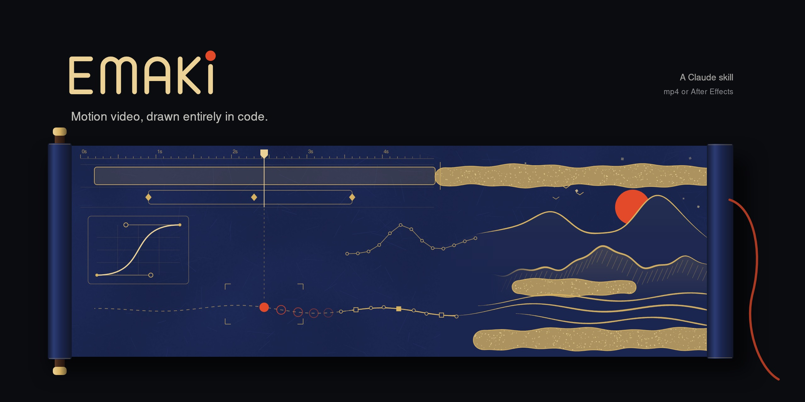

# Emaki 絵巻




**Motion video, drawn entirely in code.**
A Claude skill that makes short promo, explainer and product videos: Claude writes the film as
Python, a small engine draws every frame, and you approve it in two quick stops before the final
render. No stock footage, no generative video, no timeline editor.

Runs wherever Claude can run Python and ffmpeg: **Claude Code** · **Cowork** · **Claude apps with code execution**

---

## What it makes

- Promo and explainer clips, 10-120 s, vertical or horizontal
- Product videos with the interface recreated as vectors (cards, windows, phones, cursors, inputs)
- Kinetic typography and social reels timed to a voice-over or a beat
- Animated data: counters, bars, lines, donuts from your CSV or JSON
- An mp4 ready to post, or an editable After Effects project

## How it works

```
 You describe       Claude plans        You approve        Claude animates     You approve       Final render
┌────────────┐     ┌────────────┐     ┌────────────┐     ┌────────────┐     ┌────────────┐     ┌────────────┐
│  Stage 0   │ ──→ │  Stage 1   │ ──→ │   GATE 1   │ ──→ │  Stage 2   │ ──→ │   GATE 2   │ ──→ │  Stage 3   │
│   Brief    │     │  Concept   │     │Style frames│     │  Animatic  │     │ Animatic + │     │   Final    │
│            │     │  and look  │     │  (stills)  │     │ with sound │     │   sound    │     │  1080p mp4 │
└────────────┘     └────────────┘     └────────────┘     └────────────┘     └────────────┘     └────────────┘
```

1. **Brief.** Topic, platform, length, language, your copy (used word for word), brand sources,
   references. Video references get analysed frame by frame: motion first, then light, then
   palette.
2. **Concept and look.** One continuous shot: a carrier object that turns into each next idea, a
   camera path, a beat list on the music grid, and a design file with palette, type, light and
   easing. Every decision says why.
3. **Gate 1: style frames.** Three to five key moments rendered at final quality in seconds.
   You judge the look on stills, where changes are cheap.
4. **Animatic.** The whole film at half size with the real sound mix, automated QA and an
   independent critic pass.
5. **Gate 2.** You watch the animatic and check the sound by ear.
6. **Final.** 1080 px on the short side, 2x supersampled, -14 LUFS. Edits after delivery
   re-render only the two-second chunks that changed.

**Sketch mode** skips both gates for a quick style test: one preview, then the final.

## Why it doesn't look like a slide deck

Most code-made video is a slideshow: things slide in, sit, and fade to the next slide. Emaki is
built against that, and checks it automatically.

- **One continuous shot.** A carrier lives through the whole film: a dot writes a word, becomes
  a target, stretches into a line, unfolds into a grid.
- **Transitions are transformations**: morph, split, unfold, zoom through a detail, whip with
  motion blur. Never fade out and in.
- **An operated camera** pushes into what matters, follows the carrier, travels across one big
  canvas. It never wobbles.
- **No dead holds.** While you read a phrase, something keeps moving.
- **Light and material in every frame**: one light source, a real dark and a real light, soft
  shadows, depth of field, grain.

## What's inside

| part | what it does |
|---|---|
| Engine (skia-python, HarfBuzz) | text with per-letter animation, shapes and morphs, UI kit, charts, particles, images and SVG, camera with depth of field, transitions, light, glass, soft shadows, motion blur |
| Sound (numpy, scipy) | synthesized music bed in 9 genres, sound effects on the beat grid, voice-over word alignment, mixing and mastering to -14 LUFS / -1 dBTP |
| QA (20+ checks) | safe zones, reading time, contrast, missing glyphs, slideshow detection, frozen frames, easing, beat sync, loudness, light and tonal range |
| Critic | an independent review against a yes/no rubric at both gates, run as a separate agent where the app allows it |
| After Effects export | an ExtendScript project with layers, keyframes and expressions, checked against a mock AE before you open it |
| Five example styles | editorial, neon tech, data, playful geometric, terminal |

Measured in a Linux sandbox on a 47.5 s product film at 1080p: style frames in 3 s, the animatic
in 20 s, the final in 1.5-2 minutes.

## Install

**Claude Code (plugin):**

```
/plugin marketplace add bypshkn/emaki-motion-video
/plugin install emaki@emaki
```

**Claude Code (plain skill):** copy `skills/emaki` to `~/.claude/skills/emaki`.

**Claude apps and Cowork:** download `emaki.zip` from
[Releases](https://github.com/bypshkn/emaki-motion-video/releases) and upload it in the Skills section of
your settings (Settings → Capabilities, or Customize → Skills, depending on the app version).
Code execution must be on.

**Requirements:** Python 3.10+ and ffmpeg. On the first run the skill calls
`scripts/setup_env.sh`, which installs the missing Python packages (skia-python, numpy, scipy,
pyyaml, uharfbuzz, pillow, fonttools) within the versions in `scripts/requirements.txt`. On
macOS, install ffmpeg with `brew install ffmpeg`. If pip refuses to install into your system
Python, the script stops and prints how to make a separate environment (venv) for Emaki. It
never overrides that refusal on its own. For the After Effects output:
After Effects 24+, and Node.js if you want the project checked against a mock AE first.

## Use it

Just ask for a video. For example:

- "Make a 30-second vertical promo for our scheduling app. Copy below, English, calm and premium."
- "Sketch a 10-second style test: editorial look, one red accent."
- "Here is my voice-over. Turn it into a kinetic typography reel for LinkedIn."
- "Same film, but as an After Effects project."

Give it what it cannot invent: your copy, your brand colours or site, your voice-over or a
licensed music track, and video references you like.

Each video is a folder (`videos/<date>-<slug>/` in your working folder unless you name one):
`brief.yaml`, `design.yaml`, `storyboard.md`, `video.py`, your `assets/` and `fonts/`, and `out/`
with the style frames, the animatic, QA reports and the final.

## Your taste library (optional)

`motion-lib-template/` is an empty library. Copy it as `motion-lib/` above your video projects,
and every new video starts from the references you analysed, the techniques you collected, the
styles you approved and the engine extensions that worked. See its
[README](motion-lib-template/README.md).

## Honest limits

- **Claude cannot listen.** The synthesized bed is simple and must be checked by ear. For
  anything that matters, bring a voice-over or a licensed track.
- **No generated imagery or live footage.** Everything on screen is drawn by code or comes from
  your files.
- **Fonts are yours to bring** when the style needs a specific one. The skill names one free
  font and keeps working on the closest available until you add it.
- **Long renders run in chunks.** If your environment limits how long a command may run, the
  render stops at a time budget and continues on the next call.

## Repository

```
emaki/
├── README.md
├── skills/emaki/              ← the skill
│   ├── SKILL.md               ← workflow, gates, hard rules
│   ├── references/            ← motion, art direction, sound, QA, critic, API, styles
│   ├── scripts/               ← mv.py (CLI), engine/, audio/, ae/, qa.py, analyze.py
│   ├── assets/templates/      ← brief, design, storyboard, video.py
│   └── tests/                 ← smoke, regression, light and dynamics demos
├── motion-lib-template/       ← optional taste library, empty
├── docs/                      ← hero image and the code that draws it
└── .claude-plugin/            ← plugin and marketplace manifests
```

## Why "Emaki"?

**絵巻 (emaki)** are Japanese illustrated hand scrolls. You read one by unrolling it from right
to left, an arm's length at a time: scenes flow into each other with no frames between them, and
your hands move the view like a camera. That is the idea this skill is built on: one continuous
shot, travelling across one big canvas. Isao Takahata, co-founder of Studio Ghibli, called the
12th-century scrolls a kind of proto-animation in his book 十二世紀のアニメーション
(*Twelfth-Century Animation*, 1999).

The hero image is drawn in code too (`docs/hero/hero.py`). It borrows konshi kinji, gold ink
on indigo-dyed paper, the way 12th-century Japan made its finest scrolls. Read right to left, a
gold-line landscape turns into a motion timeline drawn with the same line: the water becomes a
bezier path, the ridge a wireframe, the mist band a clip, and the vermilion sun the keyframed dot
the camera follows.

Sibling of [Katagami 型紙](https://github.com/bypshkn/katagami), a methodology for building
design systems with AI.

## Credits

- Motion rules draw on [HyperFrames](https://github.com/heygen-com/hyperframes) motion principles,
  the LottieFiles [motion-design skill](https://github.com/LottieFiles/motion-design-skill) and
  [design-motion-principles](https://github.com/kylezantos/design-motion-principles).
- 2026 trend notes: Product Hype, AutoAE and Tangence trend roundups. Safe zones: Upload-Post.
- Built on [skia-python](https://github.com/kyamagu/skia-python),
  [uharfbuzz](https://github.com/harfbuzz/uharfbuzz), numpy, scipy and ffmpeg.

---

**Created by [Anton Pushkin (PSHKN)](https://github.com/bypshkn)**, built with Claude (Opus 5.5)
as the coding partner.

MIT License: use it, fork it, improve it.
